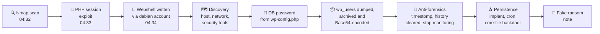

# 🥇 Operation PHP2Shell: The Hartwell Breach

**Threat hunt and incident response report · 1st place, LOG(N) Pacific community threat hunt**


An attacker exploited a PHP flaw on a medical group's public WordPress server, planted a webshell, stole database credentials and user password hashes, set up three backdoors and left a fake ransom note. I reconstructed the attack minute by minute from seven Sentinel log tables, separating what the logs prove from what they only suggest.

📄 **[Read the full report](REPORT.md)** · 🔎 **[All 33 KQL queries](queries/)** · 🛡️ **[Detection rules](detections/)**

---

## At a glance

| | |
|---|---|
| **Scenario** | Hartwell Medical Group's patient appointment website (WordPress on Debian) |
| **Host** | debian13 (192.168.1.120) |
| **Attacker** | 192.168.1.100 |
| **Window** | 2026-10-23, 04:00 to 16:00 UTC |
| **Data** | 7 Microsoft Sentinel custom tables: Apache access, Apache error, enriched HTTP, Sysmon for Linux, auditd, auth.log, syslog |
| **Hunt** | 18 flags across 8 sections |
| **Outcome** | Investigated, **not contained**: the implant was still running when the window closed |

## What happened

Within **three minutes** of the first exploit request, the attacker had:

1. Explored the server, its network and its security tools
2. Read the database password from `wp-config.php`
3. Queried the WordPress user table, including password hashes
4. Packed and Base64-encoded the data to send back through the webshell
5. Tried to stop Sysmon, auditd and the Splunk forwarder and to erase its tracks
6. Set up three ways back in, including a backdoor hidden in a WordPress core file
7. Left a ransom note claiming patient records were encrypted

The monitoring kept recording throughout. The logs show **no encryption** and **no query against patient data**. Later that day someone deleted the webshell and the note, but left two backdoors in place. The attacker was back within minutes.

## Attack chain



## Timeline (UTC, 2026-10-23)

| Time | Event |
|---|---|
| 04:32:44 | 192.168.1.100 scans with the Nmap Scripting Engine |
| 04:33:53 | First exploit run: POST /index.php with PHP session warnings |
| 04:34:31 | An SSH session as `debian` writes `health-check.php` to the web root |
| 04:34:34 | The webshell runs its first command (`id`) |
| 04:35:20 | Discovery, `wp-config.php` read, `wp_users` queried and archived |
| 04:36:21 | Timestomp, implant moved to `/dev/shm`, attempt to stop monitoring, history cleared |
| 04:37:19 | Cron persistence, backdoor added to `wp-includes/version.php`, ransom note written |
| 12:18:05 | Second exploit run, then the same pattern again |
| 12:26:43 | **All seven log tables go silent for 78 minutes** |
| 13:52:38 | root deletes the webshell, note and cron job, but not the implant or backdoor |
| 13:53:35 | Third exploit run, 57 seconds after the cleanup |
| 14:01:23 | Commands arrive in a custom `X-HMG-Debug` header (ROT13 + Base64) |
| 15:55:01 | Last implant run in the window: still active |

## Findings

| # | Finding | Confidence |
|---|---|---|
| F1 | One external host scanned and exploited the server; the webshell was written by the `debian` account | High / Medium |
| F2 | The webshell took ROT13 + Base64 commands in a custom header and ran them as `www-data` | High |
| F3 | The attacker mapped the host, network and monitoring, searching for nine security products | Medium |
| F4 | Database credentials read from `wp-config.php` and used to query WordPress password hashes | High |
| F5 | Attempts to blind monitoring and cover tracks failed where it can be measured | Medium |
| F6 | Three persistence mechanisms; the cleanup removed one and left two | High |
| F7 | Data staged, encoded and returned through the webshell; the ransom claim is not supported | Medium |
| F8 | No evidence of lateral movement; look-alike activity triaged | Medium |

Each finding in the [report](REPORT.md#06-findings) follows the same structure: **state it**, **show it** (with the query that proves it), **interpret it** (with a confidence level).

## Proven vs not proven

A big part of this hunt was being precise about what the evidence supports.

| ✅ Proven | ❌ Not proven |
|---|---|
| The database password was read and used | What the attacker's commands returned (no output is logged) |
| The user table, including password hashes, was queried | That the data left: response bodies aren't logged, only their sizes |
| The webshell sent responses while the data was being encoded | How the attacker came to act through the `debian` account |
| auditd kept recording through the attempts to stop it | Anything in the 78-minute logging gap |
| No encryption command ran in the first attack | That patient records were encrypted, as the ransom note claimed |

## MITRE ATT&CK

| Tactic | Techniques |
|---|---|
| Reconnaissance | T1595.002 Vulnerability Scanning |
| Initial Access | T1190 Exploit Public-Facing Application · T1078.003 Local Accounts |
| Execution | T1059.004 Unix Shell · T1059.006 Python |
| Persistence | T1505.003 Web Shell · T1053.003 Cron |
| Defense Evasion | T1027 Obfuscated Files · T1562.001 Disable or Modify Tools (failed) · T1070.006 Timestomp · T1070.003 Clear Command History · T1070.004 File Deletion · T1564.001 Hidden Files |
| Discovery | T1082 · T1033 · T1016 · T1049 · T1018 · T1518.001 Security Software Discovery |
| Credential Access | T1552.001 Credentials In Files |
| Collection | T1213.006 Databases · T1074.001 Local Data Staging · T1560.001 Archive via Utility |
| Command and Control | T1105 Ingress Tool Transfer · T1132.001 Standard Encoding |

Full mapping with evidence references in [Appendix B.3](REPORT.md#b3-mitre-attck-mapping).

## Detections I built

Each rule was validated against the full day of data and returned only attacker activity.

| Rule | Detects | Source |
|---|---|---|
| [D1](detections/D1-php-session-warnings-exploit-attempt.kql) | Bursts of PHP session warnings from one client (exploit attempts) | Apache error log |
| [D2](detections/D2-web-server-spawning-shell.kql) | The web server starting a shell as `www-data` | Sysmon for Linux |
| [D3](detections/D3-execution-from-temp-directory.kql) | Programs running from `/tmp` or `/dev/shm` | auditd |

## Top recommendations

1. **Disable PHP session upload progress** and upgrade PHP once a fixed release is confirmed
2. **Lock the `debian` account**, rotate its credentials and remove the unexplained SSH key
3. **Restore WordPress core files** from a clean copy, starting with `wp-includes/version.php`
4. **Make the web root read-only** to the web server and block PHP's command functions
5. **Rotate the database password** and force WordPress password resets

## Repository contents

```
├── README.md        This summary
├── REPORT.md        Full incident response report (11 sections + appendices)
├── queries/         33 KQL queries, one file each
├── detections/      3 validated detection rules
└── images/          Query result screenshots
```

## Use of AI

I used Claude (Anthropic) as an assistant during the hunt and on the report. It drafted KQL queries and suggested answers; I ran every query myself, checked each answer against the returned rows and chose what to submit. Every fact, number and timestamp comes from a query result in the report's appendix.

---

**Author:** Aldo Anthony · [LinkedIn](https://www.linkedin.com/in/aldoanthony) · [GitHub](https://github.com/aldoAnthony)

Part of my [Cybersecurity Internship Portfolio](https://github.com/aldoAnthony/Cyber-Security-Internship-Portfolio).
